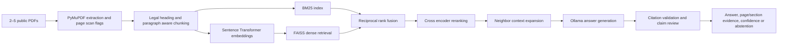

# LexiSyncAI

**Evidence-grounded legal document analyst** built for the Deep Learning & GenAI project. LexiSyncAI indexes public legal PDFs, retrieves supporting passages, and generates cited answers with an abstention path.

## Run locally

Requirements: Python 3.11, Ollama, and enough disk space for the embedding and reranker models. The first model use downloads Sentence Transformers models if they are not already cached.

Install and start with the Windows launcher:

```powershell
ollama pull qwen2.5:3b
.\run.ps1
```

The launcher creates `.venv` if needed, installs the pinned project dependencies, and starts Streamlit. The first run may take time while pip installs packages and the local embedding/reranker models download.

Manual setup is also available:

```powershell
py -3.11 -m venv .venv
.\.venv\Scripts\Activate.ps1
python -m pip install -e .
streamlit run app.py
```

Ollama must be running locally. Configure `OLLAMA_BASE_URL` and `OLLAMA_MODEL` in a root `.env` file if the defaults (`http://localhost:11434` and `qwen2.5:3b`) do not fit your setup. `.env.example` documents the supported variables.

In the app, create a case, upload 1–5 public PDFs (2–5 for a normal case; one is supported for the unseen-PDF exam demo), select **Index documents**, then ask questions. Each case has its own persisted index. Uploads are stored under `data/uploads/<case-name>/`; the FAISS index and chunk metadata are stored under `storage/indexes/<case-name>/`. Re-indexing a case replaces only that case's index; other cases remain isolated.

For a quick demo, `data/raw/gdpr.pdf` is included. Pair it with another suitable public legal PDF to meet the 2-document case workflow. Do not upload confidential client material.

## Architecture

The standalone handout is [docs/architecture.svg](docs/architecture.svg).



## Components

- **Ingestion:** extracts page text in reading order and preserves page numbers. Pages with little extracted text are flagged as potentially scanned. OCR is not currently run, and flagged pages cannot provide searchable evidence.
- **Chunking:** splits on detected legal headings and prefers paragraph boundaries while keeping source page and section metadata.
- **Retrieval:** combines BM25 clause-number matching with FAISS dense retrieval using reciprocal rank fusion; a cross encoder reranks candidates. Query expansion and neighboring context are supported.
- **Generation:** Ollama answers from retrieved excerpts. Citation IDs are validated, missing/invalid citations receive one repair attempt, and claims are checked against cited evidence. The UI expands citation IDs into document, page, and section labels and displays the cited PDF page beside the answer.
- **Abstention:** empty retrieval produces a direct insufficient-evidence response. Claim review can flag unsupported/inconclusive claims; automated outputs still require human review.

## Evaluation

The held-out benchmark contains 18 GDPR questions: 14 answerable questions and 4 intentionally unanswerable questions. Questions use expected article labels as retrieval ground truth. It reports dense-only and hybrid/reranked Recall@k and retrieval latency.

```powershell
python scripts/evaluate_held_out.py
```

To generate retrieval-grounded answers and measure abstention behavior and generation latency (the dense-only versus hybrid comparison remains the retrieval ablation):

```powershell
python scripts/evaluate_held_out.py --generate
```

This writes `evaluation/held_out_results.json` incrementally. It runs a local answer and claim-review loop for every question and can take a long time. To run a smaller smoke evaluation, choose IDs; that writes `evaluation/held_out_results_selected.json`:

```powershell
python scripts/evaluate_held_out.py --generate --ids q01,q15,q16,q17,q18 --generation-timeout 60
```

Generation failures and timeouts are recorded so one slow question does not discard completed work. Use `evaluation/manual_scoring_template.csv` to manually score all 18 questions. For each answerable question, record manual answer correctness (0/1), claims_total, supported_cited_claims and citation precision (`supported_cited_claims / claims_total`). For every question, record whether the system's answer/abstention decision was correct and end-to-end latency. Report answer correctness, citation precision and abstention accuracy separately; do not substitute Recall@5 for answer correctness. The benchmark is grounded in the included GDPR document; for a fresh unseen document, add a separate labeled question set with expected sections before drawing conclusions.

### Measured retrieval result

Run on 12 November 2026 against the included GDPR index (535 chunks), with 14 answerable and 4 unanswerable questions, at k=5:

| Configuration | Recall@5 | Mean retrieval + reranking latency |
|---|---:|---:|
| Dense-only | 12/14 (85.7%) | Not recorded separately |
| Hybrid BM25 + dense, RRF, cross-encoder | 13/14 (92.9%) | 0.55 s/question |

Hybrid retrieval recovered Article 46 for the third-country transfer question, while Article 6 was missed by both configurations. Answer correctness and citation precision still require manual scoring of the generated answer outputs.

The five-question generation smoke sample (`q01` plus the four unanswerables) recorded 4/5 abstention accuracy for the retrieval-grounded condition. Retrieval abstained on the answerable sample because its draft did not pass citation/claim checks; this is a false abstention and shows the current conservative gate can reduce answer coverage. The per-question details are in `evaluation/held_out_results_selected.json`.

## Project layout

```text
app.py                         Streamlit user interface
src/lexisync/ingestion/        PDF extraction and page metadata
src/lexisync/chunking/         Legal section-aware chunking
src/lexisync/retrieval/        BM25, FAISS, fusion, reranking, indexing
src/lexisync/generation/       Ollama answers, validation, claim review
evaluation/                    Held-out questions and generated results
scripts/                        Evaluation and development commands
tests/                          Unit tests
```

### Manual evaluation procedure

The professor's brief requires at least 15 held-out questions, including factual questions, multi-hop questions spanning two pages, and at least 3 unanswerable questions. The current 18-question set contains 14 answerable and 4 unanswerable GDPR questions. The existing benchmark measures retrieval relevance automatically; manual answer correctness and citation precision are separate assessments.

Fill in [evaluation/manual_scoring_template.csv](evaluation/manual_scoring_template.csv) after running the full generation evaluation:

- **Answer correctness:** mark 1 only when the complete answer is factually correct and addresses all parts; otherwise 0.
- **Citation precision:** supported cited claims divided by all factual claims that carry citations. Inspect each cited page and clause.
- **Abstention correctness:** mark 1 when an answerable question receives a supported answer or an unanswerable question is refused; otherwise 0.
- **End-to-end latency:** measure from submitting the question until the final answer/abstention is displayed. Keep this separate from retrieval-only latency.

The five-question smoke evaluation is not a substitute for scoring all 18 questions. The current known false abstention on an answerable smoke question must remain visible in the report.

## Assignment demo checklist

For the live exam, prepare one unseen public PDF and three unseen questions: (1) a direct prose/factual question, (2) a multi-hop question requiring evidence from two pages, and (3) an unanswerable question. The assignment specifies a five-minute demo with a one-page architecture diagram followed by five minutes of theoretical Q&A. The UI supports one-PDF exam ingestion, although the normal project workflow should use 2–5 public PDFs. Confirm the unseen PDF is text-extractable; OCR is not implemented.

## Known limitations

- OCR, table extraction, chart/figure understanding, bounding-box citations, and public hosting are not implemented.
- Reading order reconstruction is heuristic and should be checked on multi-column or unusually formatted documents.
- Case indexes are isolated under `storage/indexes/<case-name>/`; re-indexing the same case replaces only that case's files.
- Citation and claim verification are automated checks, not legal advice or a guarantee of legal correctness. Review the displayed source page before relying on an answer.
- The held-out evaluation uses one source document and article labels as retrieval relevance judgments. It does not replace a manually scored multi-document evaluation.

## Dependencies and tests

Dependencies are pinned in `pyproject.toml`. To run the unit suite:

```powershell
python -m pytest -v
```

The application is intended for local use with public legal documents. It is an academic prototype, not a legal-advice service.
