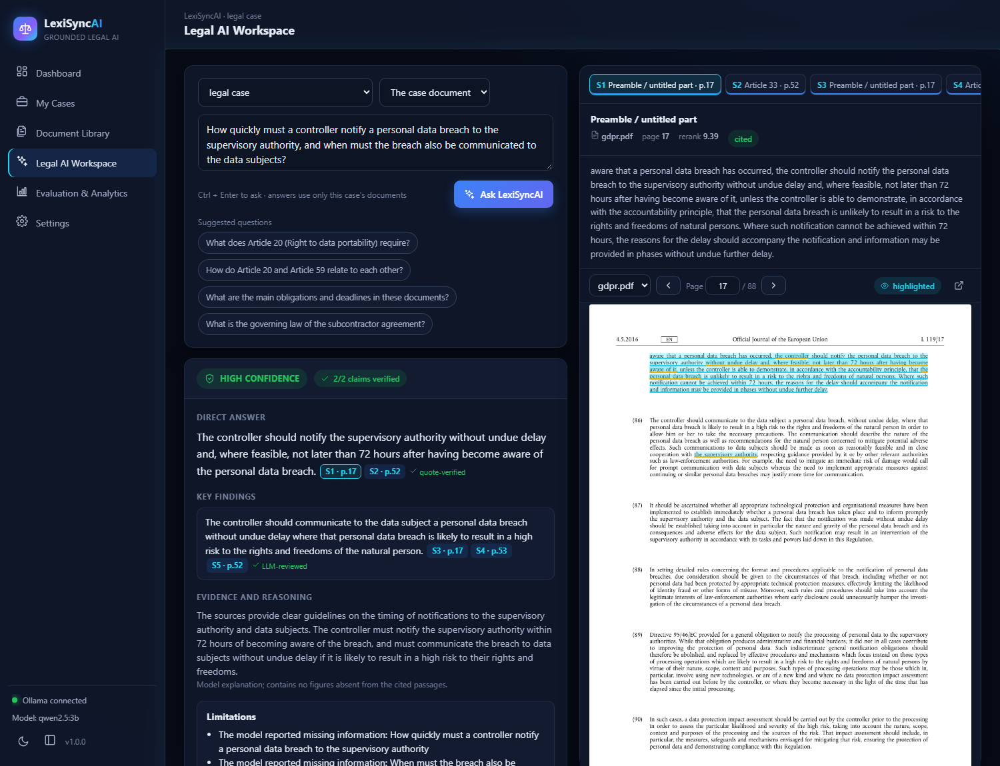
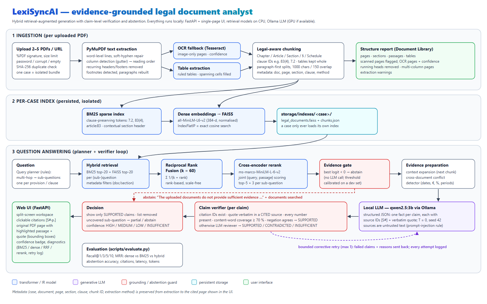
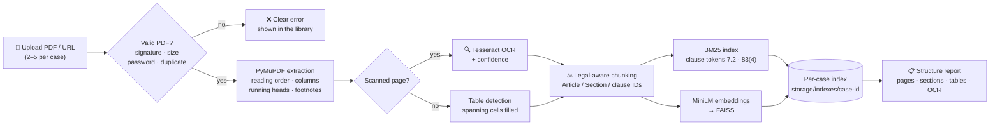
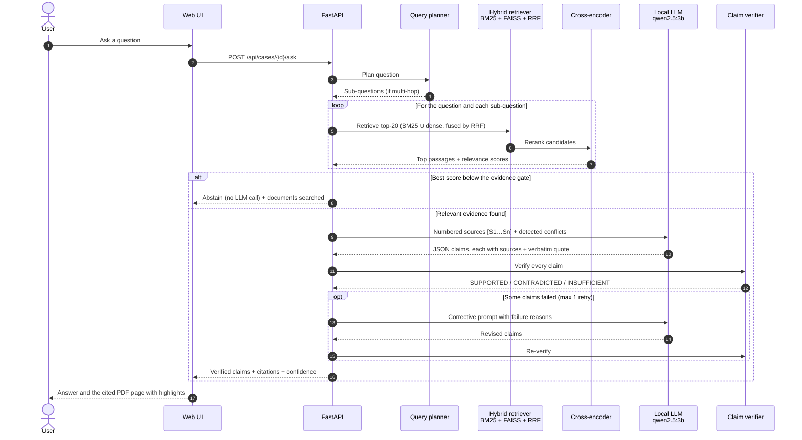
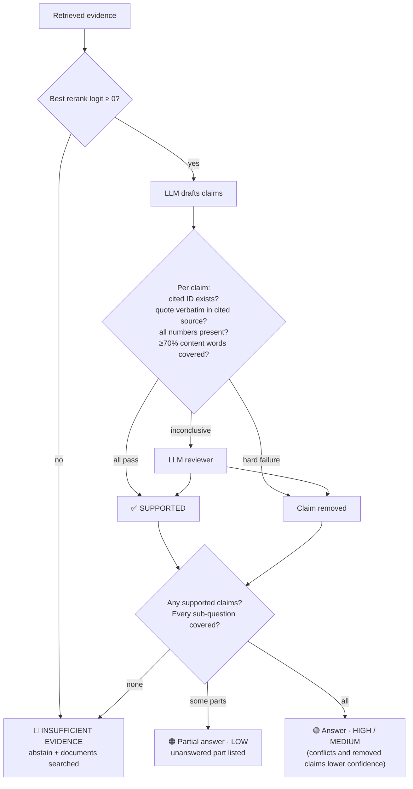
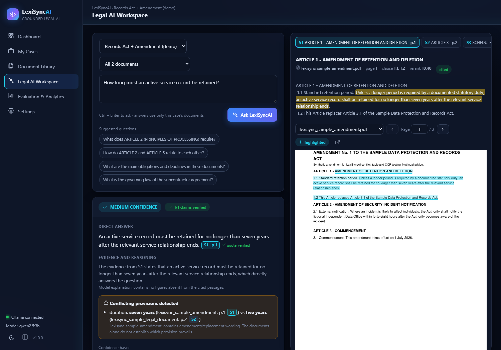
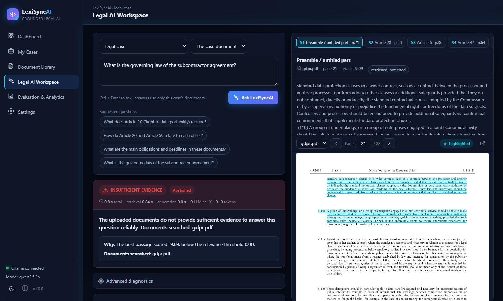
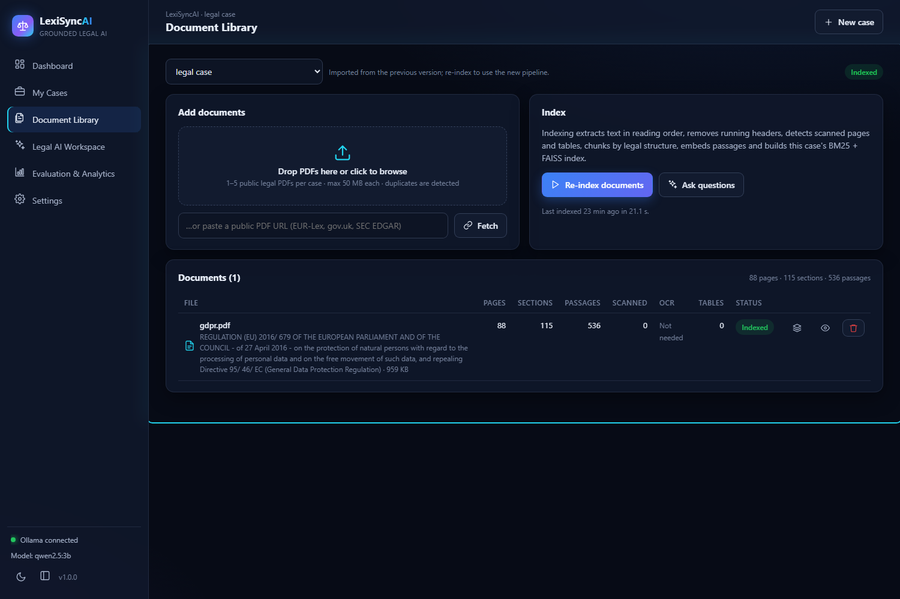
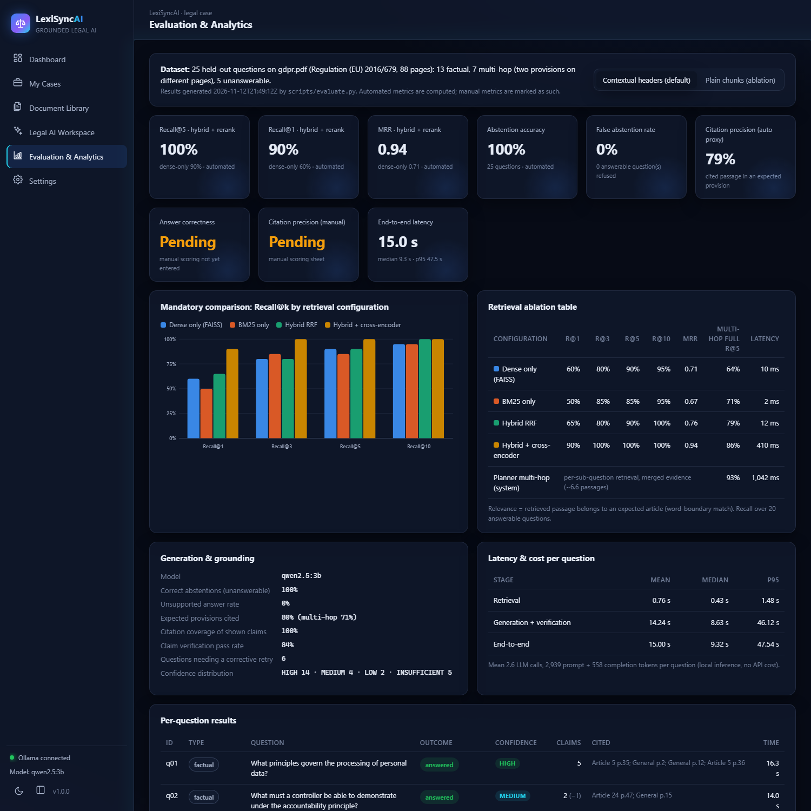

<div align="center">

# ⚖️ LexiSyncAI

### Evidence-grounded legal document analyst

**Ask questions about public legal PDFs and get answers where every claim cites its page and clause, or an honest refusal when the documents don't contain the evidence.**


[Overview](#-overview) •
[Architecture](#-architecture) •
[How it works](#-how-it-works) •
[Quick start](#-quick-start) •
[Evaluation](#-evaluation) •
[Testing](#-testing) •
[Documentation](#-documentation)



</div>

---

## 📌 Overview

LexiSyncAI is a retrieval-augmented generation (RAG) system for legal documents such as statutes, contracts, judgments and regulatory filings. A user creates a **case**, uploads 2–5 public PDFs, and asks the kind of question a lawyer, auditor or compliance officer would ask. The system:

1. **Extracts** each PDF in reading order. It handles columns, running headers and footers, footnotes and tables, and runs OCR on scanned pages.
2. **Chunks** by legal structure (Article / Section / clause such as `83(4)` or `7.2`), not by fixed size.
3. **Retrieves** with hybrid **BM25 + dense embeddings**, fused with **Reciprocal Rank Fusion** and reranked by a **cross-encoder**.
4. **Answers** with a **local LLM** that must return one fact per claim, each with a source ID and a verbatim quote.
5. **Verifies every claim** against the passage it cites. Unsupported claims are removed. If nothing survives, or the evidence is irrelevant, the system **abstains** and says which documents it searched.
6. **Shows the evidence**: clicking a citation opens the original PDF page with the passage and the exact quote highlighted.

Everything runs on your machine: no API keys, no cloud, and documents never leave the device.

> Built as the final project for the *Deep Learning & GenAI* module (DA3). Academic prototype, not legal advice.

### Highlights

| | |
|---|---|
| 🎯 **Grounded by construction** | Every displayed claim has passed citation, verbatim-quote, number and coverage checks, or an LLM review |
| 🚫 **Honest abstention** | A relevance gate, model self-report and verification failures all lead to *"The uploaded documents do not provide sufficient evidence…"* |
| 🔗 **Multi-hop answers** | A query planner splits compound questions and retrieves evidence for each part |
| ⚔️ **Conflict detection** | Differing dates, amounts, percentages or durations across documents are shown side by side |
| 🖍️ **Region-level citations** | The cited passage and quote are highlighted on the rendered PDF page |
| 📊 **Measured, not claimed** | 25-question held-out benchmark, retrieval ablation and before/after comparison, with every number reproducible |

---

## 🏗 Architecture

<p align="center">
  
</p>

The system has three layers, served by one local Python process:

| Layer | Responsibility | Key modules |
|---|---|---|
| **Ingestion** | Validate PDFs; reading-order extraction; running-head removal; footnotes; OCR fallback; tables; legal-aware chunking | `ingestion/`, `chunking/` |
| **Per-case index** | BM25 (clause-aware tokens) and FAISS (MiniLM embeddings), persisted under `storage/indexes/<case>/` and isolated per case | `retrieval/` |
| **Question answering** | Planner → hybrid retrieval → RRF → cross-encoder → evidence gate → LLM → claim verifier → decision and confidence | `retrieval/`, `generation/`, `analysis/` |
| **Application** | Case management, REST API, single-page UI with evidence viewer | `services/`, `api/`, `frontend/` |

The editable diagram is [`docs/architecture.svg`](docs/architecture.svg). [`docs/ARCHITECTURE.md`](docs/ARCHITECTURE.md) has the component-by-component design.

---

## 🔄 How it works

### 1 · Indexing flow (when documents are added)



### 2 · Question flow (when a question is asked)



### 3 · Grounding decision (what the user sees)



---

## ✨ Features

### Core requirements

| Requirement | Implementation |
|---|---|
| Ingest 2–5 PDFs or URLs per case | Drag-and-drop or URL fetch, SHA-256 duplicate detection, signature/size/encryption/corruption checks |
| Reading order, headers/footers, footnotes, columns | Word-level reconstruction, column-gutter detection, recurring margin-line removal, footnote detection |
| Scanned-page detection | Pages with no text layer are flagged; OCR runs automatically if Tesseract is installed |
| Clause/section-aware chunking | Chapter/Part/Article/Section/§/Schedule/Annex headings, clause IDs, tables kept whole |
| Hybrid retrieval + reranking | BM25 + FAISS → RRF (k = 60) → `ms-marco-MiniLM-L-6-v2` cross-encoder |
| Local LLM with page + clause citations | `qwen2.5:3b` via Ollama; structured per-claim citations; cited page shown with highlights |
| Abstention | Evidence gate calibrated on a separate dev set, plus model-insufficient and verification-failed paths |
| Confidence badge | HIGH / MEDIUM / LOW / INSUFFICIENT from measured signals (rule-based, not a probability) |
| Evaluation | 25 held-out questions; Recall@1/3/5/10, MRR; abstention, citations, latency; dense vs hybrid |

### Bonus features (assignment §4)

| # | Feature | What it does |
|---|---|---|
| 1 | **OCR for scanned pages** | Tesseract at 300 DPI on image-only pages, mean word confidence, warnings when OCR is unavailable |
| 2 | **Table extraction** | Ruled tables, spanning cells forward-filled, kept as structured chunks (tested against a manual ground truth) |
| 4 | **Bounding-box citations** | Cited passage (cyan) and exact quote (yellow) highlighted on the page image |
| 5 | **Planner + verifier loop** | Sub-question planning; bounded corrective retry with a visible retry log |
| 7 | **Ablation table** | Dense vs BM25 vs hybrid vs hybrid+rerank, with and without contextual headers |
| 9 | **Multi-document conflicts** | Differing dates, money, percentages and durations across documents, shown with both citations |
| 11 | **Latency & cost report** | Per-stage timings, LLM calls and token counts for every answer |

### User interface

| Screen | Purpose |
|---|---|
| **Dashboard** | Totals, recent cases and questions, Ollama/model status |
| **My Cases** | Create, search, reset and delete cases (with confirmation) |
| **Document Library** | Upload, index, structure report (pages, sections, OCR, tables, warnings), preview |
| **Legal AI Workspace** | Split screen: answer + confidence + verification on the left; evidence viewer with highlighted PDF page on the right; advanced diagnostics |
| **Evaluation & Analytics** | Real metrics, recall chart, ablation table, per-question results, failure analysis |
| **Settings** | Models, retrieval/grounding parameters, OCR status, light/dark theme |

<table>
  <tr>
    <td width="50%"><br/><sub><b>Conflict detection</b>: amendment vs original act, both sources cited</sub></td>
    <td width="50%"><br/><sub><b>Abstention</b>: out-of-scope question refused in under 1 s, documents searched listed</sub></td>
  </tr>
  <tr>
    <td width="50%"><br/><sub><b>Document library</b>: pages, sections, passages, OCR and table counts</sub></td>
    <td width="50%"><br/><sub><b>Evaluation dashboard</b>: retrieval comparison, abstention and latency</sub></td>
  </tr>
</table>

---

## 🧰 Tech stack

| Area | Technology |
|---|---|
| Language / runtime | Python 3.11 |
| PDF processing | PyMuPDF 2.1 (text, layout, tables, rendering), Tesseract 5 (OCR) |
| Sparse retrieval | `rank-bm25` (BM25Okapi) with clause-preserving tokenisation |
| Dense retrieval | `sentence-transformers/all-MiniLM-L6-v2` (384-d) + FAISS `IndexFlatIP` |
| Reranking | `cross-encoder/ms-marco-MiniLM-L-6-v2` |
| Generation & claim review | `qwen2.5:3b` (Q4_K_M) via Ollama; JSON mode, temperature 0, seed 42, 8k context |
| Backend | FastAPI + uvicorn |
| Frontend | Framework-free single-page app (HTML, CSS, ES modules); no build step |
| Testing | pytest (351 tests; LLM mocked) |

---

## 🚀 Quick start

### Prerequisites

| Requirement | Notes |
|---|---|
| **Python 3.11** | Check with `py -3.11 --version` |
| **[Ollama](https://ollama.com/download)** | Must be running, with the model pulled once: `ollama pull qwen2.5:3b` (about 2 GB) |
| Tesseract OCR *(optional)* | Needed only to OCR scanned pages ([Windows installer](https://github.com/UB-Mannheim/tesseract/wiki)) |

### Windows: one command

```powershell
git clone https://github.com/suvith-24/Suvith_Shetty_Deep_Learning_Project.git
cd Suvith_Shetty_Deep_Learning_Project
.\run.ps1
```

`run.ps1`:

1. checks Python 3.11 and creates `.venv`
2. installs **CPU-only PyTorch** and the pinned dependencies
3. creates `.env` from `.env.example`
4. checks that Ollama is running and the model is pulled; it never downloads models silently and prints the exact command instead
5. opens **http://127.0.0.1:8000**

| Option | Use |
|---|---|
| `.\run.ps1 -SkipInstall` | Faster restarts once dependencies are installed |
| `.\run.ps1 -Port 8001` | Use another port |
| `.\run.ps1 -NoBrowser` | Don't open the browser automatically |

If PowerShell blocks the script, run `Set-ExecutionPolicy -Scope Process -ExecutionPolicy RemoteSigned` first.

### Manual setup (any OS)

```bash
python3.11 -m venv .venv
source .venv/bin/activate                 # Windows: .\.venv\Scripts\Activate.ps1
pip install torch --index-url https://download.pytorch.org/whl/cpu
pip install -e ".[dev]"
python app.py                             # http://127.0.0.1:8000
```

The embedding and reranker models (about 100 MB) are downloaded from Hugging Face on first use and then cached.

### First steps in the app

1. **Dashboard → Create New Case**
2. **Document Library**: drop in public legal PDFs (for example from EUR-Lex), then **Index documents**
3. **Legal AI Workspace**: ask a question, click a citation chip and inspect the highlighted page
4. Open **Advanced diagnostics** to see BM25, dense, RRF and rerank rankings, claim verification and the retry log

Example questions on the GDPR:

| Type | Question |
|---|---|
| Factual | *What are the maximum administrative fines for the two tiers of GDPR infringements?* |
| Multi-hop | *How quickly must a controller notify a personal data breach to the supervisory authority, and when must the breach also be communicated to the data subjects?* |
| Unanswerable | *What is the governing law of the subcontractor agreement?* |

Optional demo documents for conflicts, tables and OCR: `python scripts/make_demo_documents.py` creates a synthetic amendment to `data/raw/lexisync_sample_legal_document.pdf`.

---

## 📊 Evaluation

**Benchmark**: 25 held-out questions on the GDPR (Regulation (EU) 2016/679, 88-page EUR-Lex PDF).

- 13 factual, 7 multi-hop (two provisions on different pages) and 5 unanswerable questions.
- Each question has an expected answer, article(s) and page(s).
- The abstention threshold was calibrated on a **separate** 14-question dev set.

### Retrieval: mandatory dense-only vs hybrid comparison

Over the 20 answerable questions; a hit means the expected article was retrieved:

| Configuration | Recall@1 | Recall@3 | Recall@5 | Recall@10 | MRR | Multi-hop full recall@5 |
|---|---:|---:|---:|---:|---:|---:|
| Dense only (FAISS) | 0.60 | 0.80 | 0.90 | 0.95 | 0.71 | 0.64 |
| BM25 only | 0.50 | 0.85 | 0.85 | 0.95 | 0.67 | 0.71 |
| Hybrid (RRF) | 0.65 | 0.80 | 0.90 | 1.00 | 0.76 | 0.79 |
| **Hybrid + cross-encoder** | **0.90** | **1.00** | **1.00** | **1.00** | **0.94** | 0.86 |
| + query planner (deployed system) | | | | | | **0.93** |

### Generation and abstention

Full system vs the original free-text generator, on **identical retrieved evidence**:

| Metric | LexiSyncAI | Original generator |
|---|---:|---:|
| Abstention accuracy | **100%** (25/25) | 20% |
| False abstentions (answerable questions refused) | **0 / 20** | 20 / 20 |
| Unsupported answers to unanswerable questions | 0 / 5 | 0 / 5 |
| End-to-end latency, mean / median | 15.0 s / 9.3 s | 40.1 s / 25.1 s |
| Citation precision, automated proxy | 79% | — |
| Claims verified by deterministic checks (no LLM call) | 74% | — |
| Answer correctness, manual citation precision | *pending manual scoring* | — |

Out-of-scope questions are refused in about 0.4 s without calling the LLM. Full details, the failure analysis and evaluation limitations are in [`docs/EVALUATION_REPORT.md`](docs/EVALUATION_REPORT.md).

To reproduce (results go to `evaluation/results/`):

```powershell
python scripts/evaluate.py                                   # retrieval ablation + calibration (~2 min)
python scripts/evaluate.py --generate                        # + full answers (~10–15 min)
python scripts/evaluate.py --generate --legacy-baseline      # + original-generator comparison
```


### Manual evaluation procedure

Answer correctness and citation precision are scored by hand; automated metrics never stand in for them (for example, Recall@5 is not answer correctness). After `python scripts/evaluate.py --generate`, open [`evaluation/manual_scoring_template.csv`](evaluation/manual_scoring_template.csv). It has one row per question. The system answer, cited sources, expected answer, number of cited claims and measured latency are pre-filled in the context columns. For each row:

| Column | How to score |
|---|---|
| `manual_answer_correct_0_or_1` | **1** only when the complete answer is factually correct and addresses all parts of the question; otherwise **0** |
| `supported_cited_claims` / `claims_total` | Open every cited page and clause; count the cited claims it really supports. `claims_total` is pre-filled with the number of cited claims shown |
| `citation_precision_0_to_1` | `supported_cited_claims / claims_total` |
| `abstention_correct_0_or_1` | **1** when an answerable question received a supported answer or an unanswerable question was refused; otherwise **0** |
| `end_to_end_latency_seconds` | Pre-filled with the measured server-side time from question to final answer or abstention; keep it separate from retrieval-only latency |
| `reviewer_notes` | Anything unusual (partial answers, recitals cited instead of articles, …) |

Report answer correctness, citation precision and abstention accuracy separately. The **Evaluation & Analytics** page reads this file and shows the manual metrics as soon as rows are scored. Until then they are marked *Pending*. For a fresh, unseen document, write a separate labelled question set with expected sections before drawing conclusions.

### Exam demo checklist

The live exam is a **five-minute demo** on one unseen public PDF with a one-page architecture diagram, followed by five minutes of theory questions. Prepare three unseen questions:

1. a direct **prose / factual** question;
2. a **multi-hop** question that needs evidence from two pages (name two provisions or join two parts with "…, and what/when/how …");
3. an **unanswerable** question (something the document does not cover).

One-PDF cases are supported for the exam; normal use is 2–5 PDFs. Scanned PDFs are OCR'd automatically when Tesseract is installed. The full timed script is in [`docs/DEMO_GUIDE.md`](docs/DEMO_GUIDE.md).

---

## 🧪 Testing

```powershell
python -m pytest -q          # 351 passed; Ollama and model downloads are mocked
```

| Test area | Examples |
|---|---|
| Ingestion | Synthetic PDFs: running heads, two-column order, tables vs manual ground truth, scanned pages + OCR, corrupt/empty/encrypted files |
| Chunking | Heading grammar, nested clause IDs, multi-page sections, large paragraphs, table chunks, page-break merging |
| Retrieval | Clause tokens, BM25/dense/hybrid/rerank modes, RRF, metadata filters, multi-hop planning and coverage |
| Grounding | Quote/number/coverage checks, corrective-retry cap, abstention paths, review budget, confidence, conflicts |
| Application | Case lifecycle, upload validation, **case isolation**, QA service, HTTP API, highlight geometry |
| Evaluation | Recall@k, MRR, abstention metrics, threshold calibration |

---

## ⚙️ Configuration

All settings live in `.env` (copied from [`.env.example`](.env.example)). No secrets are required.

| Group | Variables |
|---|---|
| LLM | `OLLAMA_BASE_URL`, `OLLAMA_MODEL`, `OLLAMA_NUM_CTX`, `OLLAMA_TIMEOUT_SECONDS`, `LEXISYNC_SEED` |
| Models | `EMBEDDING_MODEL`, `RERANKER_MODEL` |
| Retrieval | `LEXISYNC_CANDIDATE_K`, `LEXISYNC_TOP_K`, `LEXISYNC_PER_SUB_QUERY_K`, `LEXISYNC_RRF_K`, `LEXISYNC_CONTEXT_WINDOW`, `LEXISYNC_CONTEXTUAL_HEADERS`, `LEXISYNC_CHUNK_SIZE`, `LEXISYNC_CHUNK_OVERLAP` |
| Grounding | `LEXISYNC_EVIDENCE_GATE`, `LEXISYNC_HIGH_CONFIDENCE_SCORE`, `LEXISYNC_MAX_RETRIES`, `LEXISYNC_VERIFIER_MODE` |
| OCR / uploads | `LEXISYNC_OCR`, `TESSERACT_CMD`, `LEXISYNC_OCR_LANG`, `LEXISYNC_MAX_UPLOAD_MB` |

---

## 📁 Project structure

```text
LexiSyncAI/
├── app.py                      # Launcher: FastAPI + UI on http://127.0.0.1:8000
├── run.ps1                     # One-command Windows setup and start
├── frontend/                   # Single-page UI (index.html, styles.css, app.js)
├── src/lexisync/
│   ├── ingestion/              # PDF loading, layout analysis, OCR, tables
│   ├── chunking/               # Legal structure-aware chunking
│   ├── retrieval/              # BM25, FAISS, RRF, cross-encoder, planner, pipeline
│   ├── generation/             # Ollama client, grounded answerer, claim checks, confidence
│   ├── analysis/               # Cross-document conflict detection
│   ├── services/               # Case management (isolation, indexing) and QA orchestration
│   ├── api/                    # REST API and highlight geometry
│   ├── evaluation/             # Retrieval and abstention metrics
│   └── schemas/                # Page, Document and Chunk data models
├── scripts/
│   ├── evaluate.py             # Evaluation: ablation, calibration, generation, baseline
│   ├── make_demo_documents.py  # Synthetic demo amendment (conflict / table / OCR)
│   └── legacy/                 # Scripts from the earlier single-index version
├── evaluation/                 # Held-out + dev questions, results, manual scoring sheet
├── docs/                       # Architecture, evaluation, limitations, demo, theory, screenshots
└── tests/                      # pytest suite (351 tests)
```

---

## 📚 Documentation

| Document | Contents |
|---|---|
| [ARCHITECTURE.md](docs/ARCHITECTURE.md) | Pipeline design, models, case isolation, frontend decision |
| [EVALUATION_REPORT.md](docs/EVALUATION_REPORT.md) | Dataset, method, all metrics, failure analysis |
| [KNOWN_LIMITATIONS.md](docs/KNOWN_LIMITATIONS.md) | Limitations of the system and of the evaluation |
| [DEMO_GUIDE.md](docs/DEMO_GUIDE.md) | Timed five-minute demo script |
| [THEORETICAL_QA.md](docs/THEORETICAL_QA.md) | RAG, BM25, RRF, cross-encoders, Recall@K, MRR, abstention … |
| [PROJECT_AUDIT.md](docs/PROJECT_AUDIT.md) | Baseline audit and requirement gap analysis |
| [IMPLEMENTATION_ROADMAP.md](docs/IMPLEMENTATION_ROADMAP.md) | Phases, status and features not implemented |

---

## ⚠️ Limitations

- The benchmark uses one document (GDPR) and 25 questions; manual correctness scoring is still pending.
- The query planner and layout analysis are rule-based heuristics.
- The same 3B model generates answers and reviews claims.
- Confidence levels are rule-based, not calibrated probabilities.
- Verification proves *textual support* for a claim, not legal correctness.

See [`docs/KNOWN_LIMITATIONS.md`](docs/KNOWN_LIMITATIONS.md) for details.

---

<div align="center">
<sub>Use public documents only (EUR-Lex, gov.uk legislation, SEC EDGAR, CourtListener). Uploaded files stay on your machine and are excluded from version control.<br/>LexiSyncAI is an academic prototype and does not provide legal advice.</sub>
</div>
